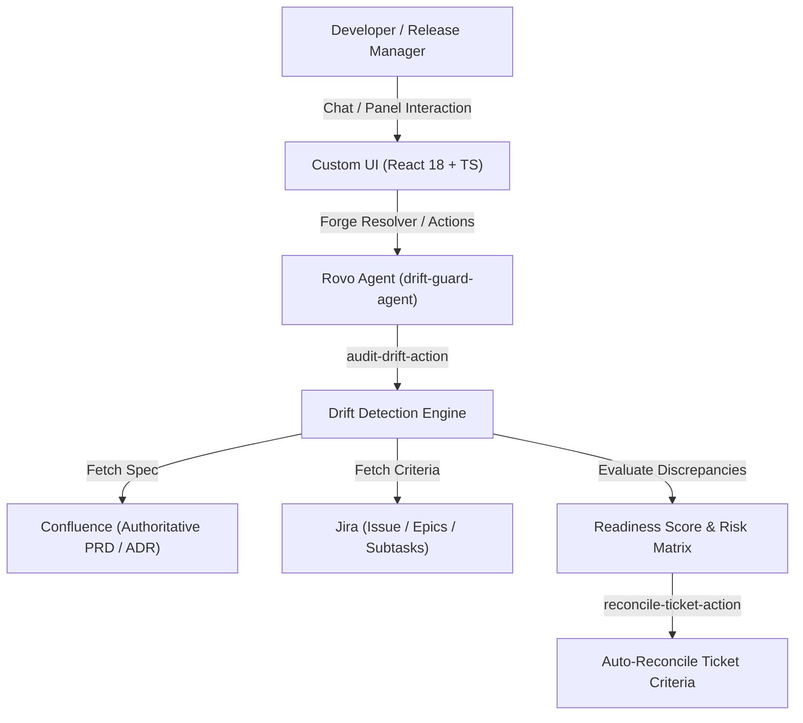

# DriftGuard AI: Rovo Autonomous Spec & Release Drift Auditor

[](https://developer.atlassian.com/platform/forge/)
[](https://www.atlassian.com/software/rovo)
[](https://codegeist.devpost.com/)
[](https://vitest.dev/)

> **Codegeist 2026 Hackathon Entry**  
> **Track:** Apps for Software Teams ($15,000 Main Prize)  
> **Target Bonus Awards:** Best Rovo Agents ($1,500) • Best Atlassian MCP / Teamwork Graph ($1,500)

---

## 1. Executive Summary & Problem

Modern high-velocity software teams suffer from **"Spec-to-Ticket Drift"**:
1. **Unsynchronized Specifications:** Product Managers update Confluence PRDs and Architects revise System Architecture ADRs mid-sprint, but Jira engineering tickets remain stale with outdated acceptance criteria.
2. **Silent Quality & Security Breaches:** Engineers complete work according to stale ticket descriptions (e.g., using deprecated MD5 hashing instead of mandated HMAC-SHA256, or omitting PCI-DSS cardholder scrubbing), resulting in critical release regressions.
3. **Blind Release Sign-offs:** Release Managers lack an automated, real-time mechanism to audit whether upcoming release candidates truly comply with their authoritative Confluence specifications.

**DriftGuard AI** bridges this gap natively inside Atlassian Cloud. Powered by an autonomous **Atlassian Rovo Agent (`rovo:agent`)** and a Forge Custom UI, DriftGuard continuously audits Confluence documents against Jira issues, computes a composite **Release Readiness Score (0-100)**, flags critical compliance gaps, and provides **1-click autonomous reconciliation**.

---

## 2. Key Capabilities & Architecture



### 2.1. Atlassian Forge Modules (`manifest.yml`)
* **`rovo:agent` (`drift-guard-agent`):** Persona-driven AI auditor that reasons over requirement diffs, classifies drift severity, and executes remediation actions.
* **`action` (`audit-drift-action`):** Deep semantic scanner that maps Confluence requirements to Jira acceptance criteria and identifies omissions or anti-pattern conflicts.
* **`action` (`reconcile-ticket-action`):** Mutating action that replaces deprecated criteria, appends missing requirements, and spawns remediation subtasks in Jira.
* **`action` (`generate-release-score-action`):** Computes a deterministically weighted Release Readiness Score (0-100) and categorizes release risk (`READY_TO_RELEASE`, `CONDITIONAL_APPROVAL`, `RELEASE_BLOCKED`).
* **`jira:issuePanel` & `confluence:contentAction`:** Contextual panel embedded directly inside Jira and Confluence interfaces.

---

## 3. Pre-configured Enterprise Test Scenarios

DriftGuard AI includes 3 built-in realistic scenarios for interactive sandbox demonstration:

| Scenario | Confluence Spec | Jira Ticket | Detected Drift & Severity | Initial Score |
| :--- | :--- | :--- | :--- | :--- |
| **1. Fintech API Gateway** | `CONF-PRD-882` (HMAC-SHA256, Redis Idempotency 72h, Rate Limit 100 req/s) | `FIN-104` (Deprecated MD5 check, missing idempotency) | **3 Critical & High Drifts:** Stale Done Status, MD5 Anti-pattern, Missing Idempotency Key, Missing Rate Limiter. | **11 / 100** (`RELEASE_BLOCKED`) |
| **2. E-Commerce Checkout** | `CONF-PRD-401` (PCI-DSS 4.0: CVV memory wipe, zero-PAN logging in Datadog) | `CHECK-209` (Stripe SDK update without CVV purge test) | **2 Drifts:** Critical CVV retention oversight, High telemetry log scrub omission. | **61 / 100** (`CONDITIONAL_APPROVAL`) |
| **3. Enterprise OAuth2 SSO** | `CONF-PRD-119` (Okta OIDC PKCE flow, state/nonce validation, JWKS caching) | `AUTH-55` (100% criteria coverage matching spec) | **0 Drifts:** Fully aligned and synchronized. | **100 / 100** (`READY_TO_RELEASE`) |

---

## 4. Local Interactive Sandbox (Judge Experience)

Judges can test the full end-to-end user experience and Rovo Agent interactions **locally in less than 30 seconds without needing an Atlassian Cloud instance**:

### Quick Start:
```bash
# 1. Clone repository & install dependencies
git clone <repo-url>
cd codegeist-2026
npm install

# 2. Run unit & integration test suite (12 tests)
npm test

# 3. Build production assets
npm run build

# 4. Launch Local Interactive Sandbox Demo
npm run preview
# Open http://localhost:4173 in browser
```

---

## 5. Atlassian Cloud Deployment Guide

To deploy DriftGuard AI directly to your Atlassian Cloud developer instance:

```bash
# 1. Login to Forge CLI
forge login

# 2. Register Forge app
forge register --name "driftguard-ai"

# 3. Deploy app to development environment
forge deploy

# 4. Install onto your Jira / Confluence Cloud site
forge install --site <your-site>.atlassian.net --product jira,confluence
```

---

## 6. Verification & Quality Rigor

```
Test Files  3 passed (3)
Tests       12 passed (12)
Duration    ~500ms
```
* **`driftEngine.test.ts` (4 tests):** Validates deterministic scoring, anti-pattern purging, and score adjustments.
* **`rovoActions.test.ts` (4 tests):** Validates Rovo agent action invocations, mutations, and resolver routing.
* **`manifest.test.ts` (4 tests):** Validates Atlassian Forge manifest schema, module bindings, and nodejs22.x runtime.
